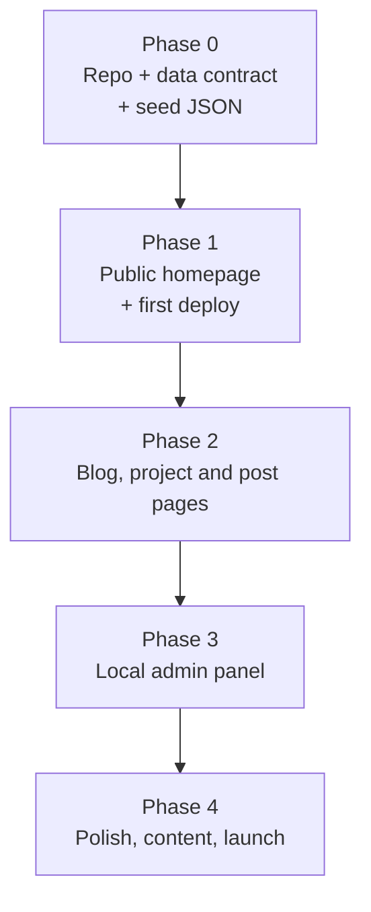

# Portfolio Site Plan
### Mohaiminul Hassan Sharukh — Vercel free subdomain first (custom domain such as `sharukh.dev` is optional and paid, ~$12/yr)

> [!NOTE]
> Stack: Plain HTML + CSS + Vanilla JS · Style: Clean, light, modern SaaS look · Hosting: Vercel (free)
> Core feature: data-driven project system + a **local-only** admin panel with GitHub import

---

## Revision Notes (what was fixed in this version)

| # | Problem in the original plan | Fix |
|---|---|---|
| 1 | "Password-gated" `admin.html` on a static public site is fake security. Anyone can read the JS and the password. | Admin lives **outside** the deployed folder (`admin/` vs `public/`) and is only run locally. No password gate. It only produces JSON files you commit. |
| 2 | Markdown rendered with `marked.js` straight into the DOM = XSS risk (marked does not sanitize since v5). | Always `DOMPurify.sanitize(marked.parse(md))`. Vendor both libs, pinned versions. |
| 3 | GitHub README endpoint returns **base64**; `atob()` breaks on UTF-8 (emoji, non-ASCII). | Request with header `Accept: application/vnd.github.raw+json` to get plain text. |
| 4 | Languages endpoint returns **bytes**, not percentages; rounding can sum to 99/101%. | Compute percentages in admin, round to 1 decimal, drop entries < 1%, store as numbers. |
| 5 | "Open file, edit, save, done" is false: `fetch()` fails on `file://`. | Use a local static server (`npx serve .` or `python -m http.server`). Documented in Phase 0. |
| 6 | Admin export could **overwrite live data** with only locally-entered data. | Admin always loads the current `public/data/*.json` as baseline, then applies edits/drafts. Re-importing a repo **merges** (never touches `notes`, `highlights`, `order`, custom `description`). |
| 7 | Contradiction: Tip says "keep one single `index.html`", but plan has 4 public pages. | Tip rewritten: index is a single-page with anchors; blog/project/post are separate pages. |
| 8 | Headings said `/blog` and `/project/:id` but files are `.html` with query params. | Headings and links all use real `.html?query` URLs. |
| 9 | Highlights: schema "up to 5", card "3–4", description "one-line" vs detail page "full description". | Fixed rules: store ≤ 5 highlights, card shows first 3; `summary` (one line) for card, `description` for detail page. |
| 10 | Hardcoded "3 Projects" stat chip contradicts "no hardcoded project data". | Chip is computed from `projects.json` length. |
| 11 | Fade-in sets `opacity: 0` in CSS: if JS fails, page is blank. Also "pure CSS" claim but uses JS observer; "just two effects" but also gradient + rotating tagline. | Gate behind `.js` class on `<html>`; add `prefers-reduced-motion`; wording corrected. |
| 12 | Phase order was wrong: admin (Phase 2) before any public rendering; "Ship Phase 1+2" had no deploy (deploy was in Phase 3). | Re-sequenced: seed data → public site + deploy → detail pages → admin → polish. First live URL after Phase 1. |
| 13 | Missing pieces: CV PDF, photo, favicon, OG meta, `vercel.json`, 404/empty/error states, nested-anchor problem on clickable cards, form accessibility/spam, SEO caveat for client-rendered pages. | All added below. |
| 14 | GitHub token stored in `localStorage` persists forever. | Store in `sessionStorage` only, never exported, never committed. |

---

## Architecture: Data-Driven Static Site with Local Admin

### How the project system works

Projects live in `public/data/projects.json`. The public site reads the JSON and renders cards dynamically. You manage content with a **local-only** admin tool that fetches from GitHub and exports JSON. You commit the JSON; Vercel redeploys.

```
┌─────────────────────────────────────────────────────────┐
│        ADMIN PANEL  (admin/index.html — LOCAL ONLY)      │
│        never deployed: Vercel output dir = public/       │
│                                                          │
│  0. Loads current public/data/*.json as the baseline     │
│  1. Enter GitHub repo URL                                │
│  2. Click "Fetch" → GitHub API pulls:                    │
│       • README (raw text → auto description/excerpt)     │
│       • Language bytes → computed % breakdown            │
│  3. You fill in:                                         │
│       • Summary (one line) + description (full)          │
│       • Highlights (up to 5)                             │
│       • Demo URL                                         │
│       • Custom tech stack tags                           │
│       • Display order / Featured toggle                  │
│  4. "Save Draft" → localStorage                          │
│  5. "Export" → download projects.json / blog.json        │
│       (optional: write directly to files via the File    │
│        System Access API in Chromium)                    │
│       → replace file in public/data/, git commit & push  │
│       → Vercel redeploys automatically                   │
└─────────────────────────────────────────────────────────┘
                            │
                    public/data/projects.json
                            │
┌─────────────────────────────────────────────────────────┐
│               PUBLIC SITE (public/index.html)            │
│                                                          │
│  fetch('data/projects.json')                             │
│    → renders project cards dynamically                   │
│    → no hardcoded HTML for projects, ever                │
└─────────────────────────────────────────────────────────┘
```

### GitHub API calls (free, no auth needed for public repos)

| Data | API Endpoint | Notes |
|---|---|---|
| README content | `GET /repos/{owner}/{repo}/readme` with `Accept: application/vnd.github.raw+json` | Returns plain text (no base64 decoding needed) |
| Language breakdown | `GET /repos/{owner}/{repo}/languages` | Returns **bytes per language** → admin converts to % |

Rate limit: 60 req/hr unauthenticated. One import = 2 requests, so that is plenty. Optional personal access token (no scopes needed for public repos) raises it to 5,000 req/hr; keep it in `sessionStorage` only.

Handle errors explicitly in the admin: 404 (bad URL / private repo), 403 (rate limit; show reset time from `X-RateLimit-Reset`), network failure.

> [!TIP]
> Parse the repo URL robustly: accept `https://github.com/o/r`, `.../o/r.git`, trailing slash, and `.../o/r/tree/main`.

### The `projects.json` schema

```json
[
  {
    "id": "tbd-backend",
    "title": "TurfBD — Multi-Tenant Sports Booking Platform",
    "github_url": "https://github.com/SharukH-9s/tbd-backend",
    "demo_url": "",
    "summary": "One-line pitch shown on the card.",
    "description": "Full description shown on the project detail page (markdown allowed).",
    "highlights": [
      "Built a custom distributed Token Bucket rate limiter using an atomic Redis Lua script",
      "Designed a Transactional Outbox Pattern with idempotency guarantees and dead-letter queuing"
    ],
    "tags": ["Rust", "Axum", "React", "PostgreSQL", "Redis", "RabbitMQ", "Docker"],
    "languages": { "Rust": 94.1, "TypeScript": 4.2, "Shell": 1.7 },
    "readme_excerpt": "First ~300 chars of README (badges/HTML/images stripped)...",
    "featured": true,
    "order": 1,
    "updated": "2026-11-08",
    "notes": [
      {
        "id": "token-bucket-upgrade",
        "title": "Why I replaced Fixed-Window with Token Bucket rate limiting",
        "date": "2026-10-15",
        "summary": "A look at boundary-loophole attacks and how Token Bucket eliminates them.",
        "content": "## Background\n\nThe fixed window counter...",
        "tags": ["redis", "rate-limiting", "rust"]
      }
    ]
  }
]
```

**Rules / validation (enforced by admin, assumed by public code):**
- `id`: lowercase slug `[a-z0-9-]+`, unique across projects; note `id` unique within its project. IDs are permanent (they are in URLs).
- `date`: ISO `YYYY-MM-DD`. Sort posts/notes by date descending.
- `highlights`: max 5; the card shows the first 3, detail page shows all.
- `languages`: numbers (percent), sum ≈ 100, entries < 1% dropped.
- `demo_url`: empty string = hide the link.
- Re-import from GitHub **merges**: refreshes `languages`/`readme_excerpt` only; never touches `notes`, `highlights`, `order`, `summary`, `description`.

> [!NOTE]
> Trade-off: notes are embedded in `projects.json`, so the homepage downloads all note bodies too. Fine for a handful of notes. If it grows, split into `data/notes/{projectId}.json` and lazy-load; this is the one schema change that would be painful later, so the public code should access notes through a single `getNotes(projectId)` function.

### The `blog.json` schema

```json
[
  {
    "id": "vps-drill-learnings",
    "title": "What I learned simulating a production VPS locally with Docker",
    "date": "2026-11-01",
    "summary": "Docker networking, multi-stage builds, and GitHub Actions CI/CD from scratch.",
    "content": "## Why I did this\n\n...",
    "tags": ["docker", "devops", "cicd"]
  }
]
```

> [!IMPORTANT]
> Both `notes` and global `blog` posts use **Markdown**, rendered with `marked` and **always sanitized with DOMPurify** before insertion: `el.innerHTML = DOMPurify.sanitize(marked.parse(md))`. Pin versions and vendor them into `public/lib/` (or use CDN + SRI hash).

### Admin panel — what it manages

```
┌─────────────────────────────────────────────────────────┐
│  🛠 Admin (local)                                        │
│  ─────────────────────────────────────────────────────  │
│  📦 Projects                                             │
│      [+ Import from GitHub]                             │
│      • TurfBD             [Edit] [Notes ▸] [Delete]     │
│      • AdaptiveWorld2D    [Edit] [Notes ▸] [Delete]     │
│      • ChatDistill        [Edit] [Notes ▸] [Delete]     │
│                                                          │
│  📝 Project Notes   (click Notes ▸ on any project)      │
│      Project: TurfBD                                     │
│      [+ New Note]                                        │
│      • Token Bucket upgrade    [Edit] [Delete]          │
│      • Outbox pattern design   [Edit] [Delete]          │
│                                                          │
│  ✍️  Global Blog                                         │
│      [+ New Post]                                        │
│      • VPS drill learnings     [Edit] [Delete]          │
│                                                          │
│  ─────────────────────────────────────────────────────  │
│  [💾 Export projects.json]  [💾 Export blog.json]        │
└─────────────────────────────────────────────────────────┘
```

**Writing posts/notes** uses a split-pane editor:
- Left: Markdown textarea
- Right: Live preview (marked + DOMPurify, same pipeline as the public site)
- Tags field + date picker + summary field
- Unsaved-changes warning on tab close; "Draft differs from live" indicator; "Discard draft / reset to live" button.

> [!WARNING]
> `localStorage` drafts are per-browser and can be wiped. The real source of truth is the committed JSON in git. Export + commit often.

---

## Architecture Decision: Why Plain HTML/CSS/JS is the right call here

- **Zero build tooling** — no webpack, no bundler, no node_modules. Edit, save, refresh. (You do need a tiny local static server because `fetch()` doesn't work on `file://`: `npx serve .` or `python -m http.server 5500`.)
- **Instant Vercel deploy** — push to GitHub, live in ~30 seconds.
- **Very fast** — no framework overhead; aim for 95+ Lighthouse (Google Fonts and images are the usual things that cost points).
- **You already know the DOM** — you built ChatDistill with Vanilla DOM + Scoped CSS.
- **Professional** — a clean static site on a Vercel subdomain looks fine to recruiters at zero cost.

**Known limitation (accepted):** `project.html` and `post.html` render client-side from query params, so link previews (LinkedIn/Slack) show generic meta tags and search engines index them weakly. Mitigation: set `document.title` and meta description dynamically, provide good default OG tags. If sharing individual posts becomes important, a ~50-line Node script that pre-generates static HTML per post can be added later without changing the data format.

---

## Folder Structure

```
portfolio/                      ← git repo root
├── public/                     ← DEPLOYED (Vercel Output Directory = public)
│   ├── index.html              ← single-page: Hero, About, Projects, Skills, Contact (anchor links)
│   ├── blog.html               ← global blog listing
│   ├── project.html            ← project detail (Overview + Notes tabs) ?id=tbd-backend
│   ├── post.html               ← single post renderer ?source=blog&id=Y  or  ?source=project&project=X&id=Z
│   ├── 404.html                ← friendly not-found page
│   ├── style.css               ← shared styles for all public pages
│   ├── main.js                 ← index logic (render from JSON, scroll animations)
│   ├── content.js              ← shared: load JSON, getProjects/getNotes/getPosts, markdown render + sanitize
│   ├── data/
│   │   ├── projects.json       ← projects + embedded notes[]
│   │   └── blog.json           ← global blog posts
│   ├── lib/                    ← vendored marked.min.js, purify.min.js (pinned versions)
│   └── assets/
│       ├── icons/              ← SVG icons (GitHub, LinkedIn, email, external link)
│       ├── favicon.svg
│       ├── og-image.png        ← 1200x630 default link preview
│       ├── photo.jpg           ← About photo (optional, emoji/avatar fallback)
│       └── Sharukh-CV.pdf      ← target of "Download CV"
├── admin/                      ← LOCAL ONLY, never deployed
│   ├── index.html
│   ├── admin.css
│   └── admin.js                ← GitHub fetch, editors, localStorage drafts, export
├── vercel.json                 ← optional: security headers, cache headers for /data
├── .gitignore
└── README.md                   ← how to run locally, how to publish content
```

**How the public pages connect:**

```
index.html                     blog.html
  └── [project card click]       └── [post card click]
        ↓                               ↓
  project.html?id=X            post.html?source=blog&id=Y
    ├── Overview tab              (renders blog.json[Y].content as markdown)
    └── Notes tab
          └── [note click]
                ↓
          post.html?source=project&project=X&id=Z
            (renders projects.json[X].notes[Z].content as markdown)
```

> [!TIP]
> `index.html` is a **single-page with anchor sections** (`#projects`, `#about`, ...). Blog, project detail and post are separate pages that share `style.css` and `content.js`.

**Local dev:** from `portfolio/` run `npx serve .` (or `python -m http.server 5500`), then open `/public/index.html` and `/admin/index.html`. Use relative paths in public pages so they work both locally under `/public/` and on Vercel at `/`.

---

## Sections Breakdown

### 1. 🏠 Hero
**Goal:** Name + tagline + CTA in under 3 seconds of reading.

```
Mohaiminul Hassan Sharukh
Backend & Full-Stack Developer

[View Projects ↓]    [Download CV]    [GitHub ↗]
```

- Full-viewport height (`min-height: 100svh`)
- Subtle animated gradient background (CSS only)
- Tagline rotates between 2 phrases (CSS animation; first phrase is the static no-motion fallback):
  - `"Building production-grade systems with Rust & React"`
  - `"Distributed systems · DevOps · AI-powered applications"`
- CTAs: **View Projects** (anchor scroll), **Download CV** (`assets/Sharukh-CV.pdf`, `download` attr), **GitHub ↗**
- Respect `prefers-reduced-motion`: no rotation, no gradient animation.

---

### 2. 👤 About
**Goal:** One paragraph human intro + a photo.

- Left: photo (emoji/avatar placeholder if none yet; `alt` text required, fixed width/height to avoid layout shift)
- Right: short bio (same tone as LinkedIn About — 3–4 sentences)
- Stat chips:

```
[ N Projects ]   [ Graduating May 2027 ]   [ Open to Work ✅ ]
```
`N` is computed from `projects.json`; the other chips are static text (update by hand).

---

### 3. 💼 Projects  ← the most important section
**Goal:** Cards rendered dynamically from `data/projects.json` — no hardcoded HTML.

**Runtime:**
```js
fetch('data/projects.json')
  .then(r => { if (!r.ok) throw new Error(r.status); return r.json(); })
  .then(projects => projects
    .sort((a, b) => a.order - b.order)
    .forEach(renderProjectCard))
  .catch(showProjectsError);
```
Always build DOM with `textContent` / `createElement` (or escape) for JSON fields; only markdown goes through the sanitizer.

Each card shows:
- **Title** + one-line `summary`
- **Language bar** — segments from `languages` (e.g. `████░ Rust 94% · TS 4%`), with text labels (not color alone)
- **Tech stack pills** (`tags`)
- **First 3 highlights**
- **Links:** `GitHub ↗` and `Live Demo ↗` (only if `demo_url` set), `rel="noopener noreferrer"`, `target="_blank"`
- **Featured badge** (top-right) if `featured: true`
- Card → `project.html?id=…`. Avoid nested `<a>`: use a "stretched link" on the title (`::after` covering the card) and keep GitHub/Demo links above it with `position: relative; z-index: 1`.

States: loading skeleton, error message with retry, empty state ("Projects coming soon").

**Order:** controlled by `order`; reorder in the admin (up/down buttons first, drag-and-drop optional).

> [!IMPORTANT]
> For TurfBD — if you have a **working live URL**, link it. Even a Loom video walkthrough (free, ~5 min to record) on the card will make it far stronger than a GitHub link alone.

---

### 4. 🛠️ Skills
**Goal:** Scannable, grouped, visual — not a wall of text.

```
Languages          Rust · Python · TypeScript · JavaScript · C#
Frameworks         Axum · FastAPI · React · SQLx · Tokio
Databases          PostgreSQL · Redis · RabbitMQ
DevOps             Docker · GitHub Actions · Caddy · Nginx · CI/CD
Observability      OpenTelemetry · Prometheus · k6
AI & Platforms     Gemini API · Chrome MV3 · Unity
```

Each group is a row; skills are small rounded pills (light grey background, dark text). Static HTML is fine here (rarely changes).

---

### 5. 📬 Contact
**Goal:** Make it effortless to reach you.

- Centered layout
- Email as a prominent `mailto:` link
- LinkedIn + GitHub icon buttons (with `aria-label`)
- **Optional:** [Formspree](https://formspree.io) form (free tier, no backend)

```html
<form action="https://formspree.io/f/YOUR_ID" method="POST">
  <label>Name <input name="name" required autocomplete="name"></label>
  <label>Email <input type="email" name="email" required autocomplete="email"></label>
  <label>Message <textarea name="message" required rows="5"></textarea></label>
  <input type="text" name="_gotcha" tabindex="-1" autocomplete="off" style="display:none"> <!-- honeypot -->
  <button type="submit">Send</button>
</form>
```
Skip the form entirely if you don't want to maintain it; the mailto link is enough. Don't ship with the `YOUR_ID` placeholder.

---

### 6. 📝 Two-Track Blog / Notes System

Two content types, both managed from the admin:

#### Track 1 — Global Blog (`blog.html`)
General engineering posts not tied to any project.

| Post idea | Source |
|---|---|
| "Why I replaced a Fixed-Window rate limiter with a Token Bucket" | `Distributed Redis Rate Limiter` upgrade doc |
| "How I designed a Transactional Outbox in Rust" | `bg_queue_implementation.md` |
| "Building a self-healing AI pipeline for a game" | `AdaptiveWorld2D` architecture docs |
| "What I learned simulating a production VPS locally with Docker" | `local_vps_drill.md` |

> [!NOTE]
> Avoid publishing the same article as both a global post and a project note. Rule of thumb: project-specific "how/why we built X" → note; general lessons → blog.

- `blog.html` — cards (title, date, one-line summary, tags); tag filter optional
- `post.html?source=blog&id=post-slug` — rendered markdown

#### Track 2 — Per-Project Notes
Every project has a notes/devlog tab.

- `project.html?id=tbd-backend` — two tabs (`#overview` / `#notes`, URL-hash driven so tabs are linkable and back-button friendly)
  - **Overview:** full description, language bar, highlights, links
  - **Notes:** posts scoped to this project, newest first
- `post.html?source=project&project=tbd-backend&id=note-slug`

Shared behaviour for `project.html` / `post.html`:
- Unknown id/source → friendly "not found" state with link home (no blank page, no JS exception)
- Set `document.title` and `<meta name="description">` from the content
- "← Back" link to the correct parent (blog list or project Notes tab)
- Reading-friendly styles: max-width ~70ch, code block styling with horizontal scroll, responsive images

> [!TIP]
> One `post.html` template handles both sources by switching data source on the query params. Zero duplication.

#### Why this structure is powerful
A recruiter clicks TurfBD → sees the Notes tab → reads "How I designed a Token Bucket rate limiter in Rust" → understands you don't just *write* code, you *think* about it.

---

## Design System (CSS Variables)

```css
:root {
  --color-bg:        #ffffff;
  --color-surface:   #f8f9fa;   /* card backgrounds */
  --color-border:    #e5e7eb;
  --color-text:      #111827;
  --color-muted:     #6b7280;   /* check: 4.8:1 on white, OK for body text; don't go lighter */
  --color-accent:    #2563eb;   /* buttons, links, highlights — blue */
  --color-accent-hover: #1d4ed8;

  --font-sans: 'Inter', system-ui, sans-serif;
  --font-mono: 'JetBrains Mono', 'Fira Code', monospace; /* tech pills/code */

  --radius-sm: 6px;
  --radius-md: 12px;
  --radius-full: 9999px; /* pills */

  --shadow-card: 0 1px 3px rgba(0,0,0,0.08), 0 4px 16px rgba(0,0,0,0.04);
}
```

**Font:** Inter via Google Fonts. Add `preconnect` links for speed; JetBrains Mono is only referenced, so either load it too or rely on the fallback stack.
```html
<link rel="preconnect" href="https://fonts.googleapis.com">
<link rel="preconnect" href="https://fonts.gstatic.com" crossorigin>
<link href="https://fonts.googleapis.com/css2?family=Inter:wght@400;500;600;700&display=swap" rel="stylesheet">
```

Accessibility baseline: visible `:focus-visible` outlines, semantic landmarks (`header/main/section/footer`), skip link, `lang="en"`, alt text, min 44px tap targets.

---

## Animations (CSS + a tiny IntersectionObserver)

Effects: (1) fade-in on scroll, (2) card hover lift, plus the hero gradient and tagline rotation. All disabled under `prefers-reduced-motion`.

1. **Fade-in on scroll** — gated so content is visible if JS fails. In `<head>`: `document.documentElement.classList.add('js')`.
```css
.js .section { opacity: 0; transform: translateY(20px); transition: opacity .5s ease, transform .5s ease; }
.js .section.visible { opacity: 1; transform: none; }
@media (prefers-reduced-motion: reduce) {
  .js .section { opacity: 1; transform: none; transition: none; }
}
```
`main.js` uses `IntersectionObserver` to add `.visible` (and `unobserve` after first reveal).

2. **Hover lift on project cards:**
```css
.card { transition: transform .2s ease, box-shadow .2s ease; }
.card:hover { transform: translateY(-4px); box-shadow: 0 8px 32px rgba(0,0,0,0.10); }
```
Dynamically rendered cards are added after load: observe them after rendering, not before.

No GSAP, no framer-motion.

---

## Deployment (Vercel — free)

```
1. Push the portfolio/ repo to GitHub (e.g. github.com/SharukH-9s/portfolio)
2. vercel.com → Import Project → select the repo
3. Framework Preset: "Other"; Build Command: (empty); Output Directory: public
   → this is what keeps admin/ OFF the internet
4. Deploy → live at https://<project>.vercel.app
5. Optional: custom domain later (paid domain; HTTPS is free)
6. Content updates = replace public/data/*.json, commit, push → auto redeploy
```

Optional `vercel.json`: security headers (`X-Content-Type-Options: nosniff`, `Referrer-Policy`, a CSP allowing self + Google Fonts + formspree), and short cache for `/data/*` so updates show up quickly.

Pre-launch checklist: CV PDF present, no placeholder text/IDs, links open correctly, OG image + meta tags set, favicon, Lighthouse run, tested on a real phone, `admin/` confirmed 404 on the live URL.

---

## Build Order (Phases — do one at a time)



| Phase | Goal | Est. time | Live result |
|---|---|---|---|
| **0** | Foundation: repo, folders, schema, hand-written seed data | 1–2 hrs | — |
| **1** | Public homepage fully working from JSON + Vercel deploy | 1 day | ✅ URL you can put on CV/LinkedIn |
| **2** | `project.html`, `blog.html`, `post.html` + shared markdown renderer | 1–2 days | ✅ Notes & blog readable |
| **3** | Local admin: GitHub import, editors, drafts, export | 2–3 days | Content workflow, no hand-editing JSON |
| **4** | Mobile/a11y/perf polish + first real posts | 1–2 days | ✅ Final launch |

> [!IMPORTANT]
> **Ship Phase 0 + 1 first.** A live URL on your CV in about a day beats a perfect site in two weeks. The admin (Phase 3) is a convenience: until it exists you can hand-edit the JSON.

---

### Phase 0 — Foundation & data contract
**Deliverables**
- [x] Git repo with `public/`, `admin/` (empty placeholder), `.gitignore`, `README.md` (how to run locally)
- [x] `public/data/projects.json` with your 3 real projects (TurfBD, AdaptiveWorld2D, ChatDistill) following the schema, ≥1 sample note on TurfBD
- [x] `public/data/blog.json` with 1 placeholder post
- [x] Vendored `public/lib/marked.min.js` + `purify.min.js` (pinned versions noted in README)
- [x] `public/style.css` with the design-system variables + reset + base typography
- [x] Local server command verified (`npx serve .`)

**Done when:** JSON files are valid, loaded in the browser console via `fetch`, and the schema rules above are satisfied.

### Phase 1 — Public homepage + first deploy
**Deliverables**
- [x] `public/index.html`: Hero, About, Projects, Skills, Contact; nav with anchor links; skip link; meta/OG tags; favicon
- [x] `main.js`: render cards from JSON (loading / error / empty states, safe DOM building), language bar, computed project-count chip, scroll fade-in (gated by `.js`), reduced-motion support
- [x] `assets/Sharukh-CV.pdf` (placeholder file, replace with the real CV) and avatar placeholder
- [x] Cards link to `project.html?id=…` (target page may be a stub until Phase 2) without nested anchors
- [ ] Deployed to Vercel with Output Directory `public`

**Done when:** live URL works on desktop and phone, no console errors, `admin/` returns 404 on the live site, Lighthouse ≥ 90.

### Phase 2 — Blog, project detail and post pages
**Deliverables**
- [x] `content.js`: `getProjects()`, `getProject(id)`, `getNotes(projectId)`, `getPosts()`, `renderMarkdown(md)` (marked + DOMPurify)
- [x] `project.html`: Overview + Notes tabs (hash-driven)
- [x] `blog.html`: listing sorted by date desc
- [x] `post.html`: both `source=blog` and `source=project`; dynamic title/meta; back links
- [x] `404.html` and in-page not-found states for bad ids
- [x] Markdown styling (code blocks, headings, lists, links, images)
- [x] XSS check: a post containing `<script>` / `onerror=` renders harmlessly

**Done when:** every link in the connection diagram works, bad URLs show a friendly state, and the XSS test passes. Push → redeploy.

### Phase 3 — Local admin panel
Split in 3 sub-steps so each can be tested alone:

**3a — Data & GitHub import**
- [x] `admin/index.html` layout + sidebar; load baseline from `../public/data/*.json`
- [x] URL parser, README (raw) + languages fetch, bytes→% conversion, error handling (404/403/network), optional token in `sessionStorage`
- [x] Project editor form with validation (slug, unique id, ≤5 highlights, URL formats); merge-on-reimport rules
- [x] Reorder (up/down) + featured toggle + delete with confirm

**3b — Notes & posts editor**
- [x] Split-pane markdown editor with live sanitized preview
- [x] Tags, date picker (defaults to today), summary field, slug auto-generation
- [x] Per-project notes CRUD and global blog CRUD

**3c — Drafts & export**
- [x] Autosave drafts to `localStorage`, "differs from live" indicator, discard/reset
- [x] Unsaved-changes warning
- [x] Export `projects.json` / `blog.json` (pretty-printed, 2-space indent, stable key order to keep git diffs small); optional File System Access write
- [x] Validate before export (block on errors)

**Done when:** you can import a repo, add a note, export, drop the files into `public/data/`, and the public site shows the changes; re-importing doesn't wipe notes.

### Phase 4 — Polish, content, launch
**Deliverables**
- [x] Mobile pass at 360 / 768 / 1280 px; no horizontal scroll; 44px tap targets
- [x] Accessibility pass: keyboard navigation, focus styles, contrast, alt text, heading order
- [x] Performance: image sizes, font loading, cache headers in `vercel.json`
- [x] Write 2+ real posts (from Upgrades docs) and 2+ TurfBD notes
- [x] Add live demo / Loom link for TurfBD if available (empty string hides link gracefully until live URL exists)
- [x] Contact form decision (direct mailto + copy email + Gmail compose: zero-dependency, spam-proof)
- [x] Pre-launch checklist from the Deployment section (admin/ confirmed 404, security headers in vercel.json)

**Done when:** checklist complete, Lighthouse ≥ 95 on Performance/Accessibility/Best Practices/SEO for index, and the URL is on your CV and LinkedIn.

---

## Ready to build?

Say **"start Phase 0"** (or any phase number) and I'll implement only that phase, then stop so you can review before moving on.
